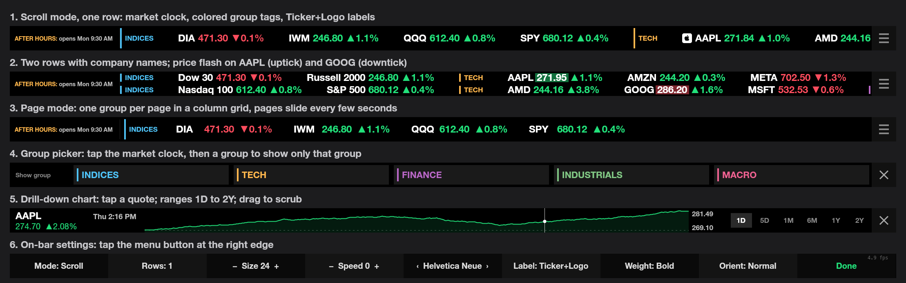

# Flex Ticker

A stock ticker plugin for the ENIAC Flexbar (2170 x 60 AMOLED touch strip), built on the FlexDesigner SDK. It shows live quotes as a scrolling or paged tape, with a market clock, watchlist groups and a full-width drill-down chart for each symbol. Developed and tested on macOS, with the code written to keep Windows and Linux in reach (see Platform support).



Frames rendered by the plugin itself, with mock quotes, at the bar's real 2170 x 60 size.

## Features
1. Ticker tape
   1. Scroll mode (a continuous marquee) or Page mode (static pages that slide vertically every few seconds; sharper on the AMOLED than scrolling).
   2. One or two rows. In two-row scroll mode each row scrolls on its own, so the rows stagger.
   3. Each quote shows label, price and day change, colored green or red.
   4. Price flash: when a price changes, a box behind it glows for 1.2 s, green for an uptick and red for a downtick. The day change keeps its own color, so a red flash beside a green change means "down this update, still up today".
   5. Labels: ticker, company name, or ticker with the company logo (one-row display only; symbols without a logo, such as ETFs, show the ticker alone).
2. Watchlist groups
   1. Named groups, each with its own color. Scroll mode puts a colored tag before each group; Page mode gives each group its own pages, with a column grid sized to that group.
   2. Quotes are sorted alphabetically by the shown label.
   3. Group filter: tap a group tag to show only that group, or tap the market clock to pick a group from a full-bar list. While filtered, only that group is polled, so it refreshes much faster.
3. Market clock
   1. A 270 px block at the left of the tape, for example `OPEN: closes 4h 13m` or `AFTER HOURS: opens Mon 9:30 AM`.
   2. Knows pre-market, regular, after hours, NYSE holidays and early closes, computed from the exchange rules with no API calls and no yearly update.
4. Drill-down chart
   1. Tap a symbol to open a full-width chart. Ranges: 1D, 5D, 1M, 6M, 1Y and 2Y.
   2. Drag across the chart to scrub: a crosshair, with price, time or date and change from the start of the range.
   3. 1D shows the most recent session (so it still works at night and on weekends) against the previous close as a dashed line.
   4. Nights and weekends leave no flat gaps, and short spikes stay visible.
5. Local price history
   1. Every quote and every Massive daily and minute bar is stored in a local SQLite database, so charts open instantly and history grows over time.
   2. A background collector backfills 2 years of daily bars and as much minute history as the Massive free plan allows.
6. On-bar settings
   1. A menu button at the right edge opens a settings strip: Mode, Rows, Size, Speed or Page time, Font, Label, Weight, Orientation.
   2. The same settings live in a JSON file that is watched and applied live.
7. Symbols: US stocks and ETFs, crypto (`BINANCE:BTCUSDT`), and the Nasdaq indices `I:NDX` and `I:COMP` (daily close only).

## Requirements
1. macOS (Windows and Linux builds exist but are untested), an ENIAC Flexbar, and FlexDesigner. FlexDesigner must be running for the bar to work: it runs the plugin and carries every frame and touch over USB. Add it to Login Items.
2. A free Finnhub API key (live quotes). Required.
3. A free Massive API key (history, charts beyond today, logos, indices). Optional; without it charts use only today's quotes.
4. git and bun. There are no prebuilt downloads yet, so the plugin is built from this repository.

## Install
All commands run in a terminal from the cloned folder.

1. Get the code: `git clone https://github.com/NOP64/flex-ticker.git`, then `cd flex-ticker`.
2. `bun install`
3. Store the keys in the OS secure store: Keychain on macOS, Credential Manager on Windows, Secret Service on Linux (each command prompts for the key, so it never appears on the command line):
   1. `bun run key:set:finnhub` (Finnhub)
   2. `bun run key:set:massive` (Massive, optional)
   3. `bun run key:check` reports which keys are stored.
4. `bun run build`
5. `bun run plugin:pack` writes `com.nop64.flexticker.flexplugin`.
6. `bun run plugin:install` installs it into FlexDesigner.
7. In FlexDesigner, drag the Flex Ticker tape key onto a page and upload it to the bar.
8. Tap the bar once. FlexDesigner only starts drawing a key after it receives a touch.

To update, run `git pull`, repeat steps 4 to 6 and tap the bar.

If you add or change an API key later, run `bun run plugin:restart` and tap the bar. The plugin reads the keys once, when it starts.

To build for other computers, `bun run plugin:pack:all` writes one package per OS and CPU into `dist/` (`flex-ticker-darwin-arm64`, `darwin-x64`, `win32-x64`, `win32-arm64`, `linux-x64`, `linux-arm64`), each with only its own native binaries. Install the matching file through FlexDesigner on that computer. That computer still needs the clone and bun to store keys with `bun run key:set:finnhub`.

## Using the bar
1. Scroll mode: tap to pause (a ▶ button appears left of the menu; tap it to resume). Drag to move the tape by hand.
2. Page mode: swipe to flip pages.
3. Tap a quote on a paused tape, or in Page mode, to open its chart. If several quotes are near the finger, a picker shows a large button for each.
4. Tap a group tag to filter to that group; tap it again to show all.
5. Tap the market clock to pick a group. While filtered, tap the clock to show all groups again.
6. Tap the menu button (three bars) at the right edge for settings. Tap the left half of a cell to decrease, the right half to increase or cycle. Done saves.
7. In a chart, tap a range chip to change range, drag to scrub, and tap X to close.

## Settings
Flex Ticker keeps its own settings file and data folder instead of using FlexDesigner's key settings:

1. Independence from FlexDesigner. FlexDesigner keeps key settings inside its profile, and a plugin cannot write them back. With its own file, FlexDesigner only deploys and runs the plugin; the settings, watchlists and history stay the same across profile changes, reinstalls and FlexDesigner updates, and the on-bar menu can save changes.
2. Room for data. The market data the plugin can collect is large: two years of daily and minute bars per symbol, quote ticks, company logos, and later news, breadth and movers. That belongs in a database in the OS data folder (`history.sqlite`), not in a profile.
3. Plain files. Settings can be edited in any text editor, backed up, copied to another computer or kept in version control.

The key's foreground and background settings in FlexDesigner have no effect. The plugin draws the whole 2170 x 60 bar as one full-screen image, so there is nothing for FlexDesigner to color.

File: `settings.json` in the Flex Ticker config folder (see Data folders below), created with defaults on first run. `bun run settings:open` opens it in a text editor. Edits apply live. Invalid JSON keeps the last good settings and logs `settings file invalid`; invalid values fall back to defaults.

1. `mode`: `scroll` or `page`.
2. `rows`: `1` or `2`.
3. `speed`: scroll speed in px/s, 0 to 300. Default 40. Multiples of 20 move a whole number of pixels per frame and look smoothest.
4. `dwell`: seconds per page in Page mode, 2 to 60.
5. `font`: an installed font name. Defaults: Helvetica Neue on macOS, Segoe UI on Windows, DejaVu Sans on Linux. On macOS, Helvetica Neue, Avenir Next and Verdana have real bold and heavy weights; DIN Alternate, DIN Condensed, Impact and Arial Black have one weight only.
6. `weight`: `normal`, `bold` or `900`.
7. `size`: text size in px, 14 to 48. Capped at 26 with two rows. 24 is a good default; 18 is the practical minimum.
8. `label`: `ticker`, `name` or `logo` (ticker with logo).
9. `orientation`: `auto` (follow FlexDesigner's screen flip), `normal` or `rotated`.
10. `groups`: a list of `{ "name": "Tech", "symbols": ["AAPL", "MSFT"] }`. Symbols may also be one string, space or comma separated. They are uppercased and deduplicated.

Example:

```json
{
  "mode": "scroll",
  "rows": 1,
  "speed": 40,
  "size": 24,
  "label": "logo",
  "groups": [
    { "name": "Indices", "symbols": ["SPY", "QQQ", "DIA", "I:NDX"] },
    { "name": "Tech", "symbols": "AAPL MSFT NVDA" },
    { "name": "Macro", "symbols": ["GLD", "USO", "BINANCE:BTCUSDT"] }
  ]
}
```

## Data folders
The plugin picks its folders from the host OS (`src/paths.js`), with nothing to configure. Both folders survive plugin reinstalls and updates.

| OS | Settings (`settings.json`, `snaps/`) | History (`history.sqlite`) |
|---|---|---|
| macOS | `~/Library/Application Support/flex-ticker` | same folder |
| Windows | `%APPDATA%\flex-ticker` | `%LOCALAPPDATA%\flex-ticker` (large, so it stays out of the roaming profile) |
| Linux | `~/.config/flex-ticker` (or `$XDG_CONFIG_HOME/flex-ticker`) | `~/.local/share/flex-ticker` (or `$XDG_DATA_HOME/flex-ticker`) |

How the OS is detected:

1. `process.platform` from Node. It is fixed when Node is built, so it reports the real OS with no probing: `darwin` on macOS, `win32` on any Windows (32 or 64 bit), `linux` on Linux. Any other value (for example `freebsd`) gets the Linux layout.
2. The home folder comes from `os.homedir()`: `$HOME` on macOS and Linux, `%USERPROFILE%` on Windows.
3. Windows: `%APPDATA%` and `%LOCALAPPDATA%` are set by Windows for every user session. If either is missing, the plugin uses `AppData\Roaming` or `AppData\Local` under the home folder.
4. Linux: follows the XDG Base Directory standard. `$XDG_CONFIG_HOME` and `$XDG_DATA_HOME` are used when set, otherwise `~/.config` and `~/.local/share`.
5. Paths are built with the separators of the target OS (`path.win32` or `path.posix`), and the folders are resolved once when the plugin starts. `src/paths.js` takes the platform as a parameter, so tests check all three layouts on one machine.

## Symbols
1. Supported:
   1. US stocks and ETFs, for example `AAPL`, `BRK.B`, `SPY`.
   2. Crypto as Finnhub exchange symbols, for example `BINANCE:BTCUSDT`. Ticker labels drop the exchange prefix. History comes from Massive as `X:BTCUSD`.
   3. Nasdaq indices `I:NDX` and `I:COMP`, from Massive history. The tape shows the last daily close and its change, tagged `close`.
2. Not supported on the free plans:
   1. Yahoo-style symbols (`BTC-USD`, `CL=F`, `^GSPC`).
   2. S&P 500, Dow and VIX index values (`^GSPC`, `I:SPX`, `I:DJI`, `I:VIX`): Finnhub and Massive both require a paid plan.
   3. Mutual funds and non-US listings.
3. Common proxies: S&P 500 as `SPY`, Dow as `DIA`, VIX as `VIXY`, oil as `USO`, gold as `GLD`. Note that `GOLD` is Gold.com Inc, not gold.
4. Company names come from Finnhub, fetched once per symbol and cached. Common ETFs and crypto are named in `src/groups.js`.

## Data sources
1. Finnhub (live quotes)
   1. Polls `/quote` one symbol at a time, round robin, at 50 calls a minute (the free limit is 60). 55 symbols refresh about every 66 s; a filtered group of 4 refreshes about every 5 s.
   2. Follows the market session: every 1.2 s in regular hours, 15 s pre-market and after hours, 5 min when closed. Crypto is also quoted every 60 s outside regular hours.
   3. On HTTP 429 it pauses 60 s. Unknown symbols are skipped.
   4. Free quotes do not update in pre-market or after hours, so the tape shows the regular close then, while brokers show extended-hours prices.
2. Massive (history, logos, indices)
   1. Free plan: 2 years of daily bars and minute bars (4 am to 8 pm ET), through yesterday. Today comes from Finnhub.
   2. The collector makes one call every 13 s, in this order:
      1. Daily backfill: 2 years for any symbol without daily bars.
      2. Daily update: one grouped call per missing trading day covers every US stock; crypto and indices go per symbol.
      3. Minute update: from the last stored day through yesterday.
      4. Logos: two calls per stock or ETF (overview, then icon), once each.
      5. Minute backfill: 40 days per call (30 for crypto), breadth first, until Massive has no more.
   3. Finished requests (holidays, history floor, symbols without a logo) are recorded and never repeated.
   4. Adding a symbol to `settings.json` starts its backfill automatically.
3. Storage: `history.sqlite` in the history folder (see Data folders)
   1. `ticks`: every Finnhub quote. Deleted after 7 days once Massive minute bars cover them.
   2. `bars`: daily and minute OHLCV bars. About 72 bytes per bar; full minute history for 55 symbols is about 27M bars, about 2 GB.
   3. `logos`: company icons as 64 px PNG, about 1 KB each.
   4. `done`: finished collector requests.
4. Keys: see API key security.

## API key security
On macOS the keys live in the login Keychain, never in a file the plugin reads or writes.

1. Encrypted at rest. Keychain items are encrypted with a key protected by the user's login password. Copying the disk or the home folder does not expose them.
2. Locked with the user. The login keychain unlocks at login and is not readable by other user accounts.
3. Access controlled per item. An item created with `security add-generic-password` lists which programs may read it without asking. The plugin reads it through `/usr/bin/security`, which is on that list, so there is no prompt; any other app that tries gets a macOS permission dialog.
4. Never on the command line. `bun run key:set:finnhub` and `bun run key:set:massive` prompt for the key, so it never lands in shell history or the process list.
5. Never in the project or FlexDesigner. Keys are not in the repo, `settings.json`, the plugin's `config.json`, FlexDesigner profiles or the packed `.flexplugin`. Profiles and plugins can be shared without leaking them.
6. Never in URLs or logs. Keys are sent in request headers (`X-Finnhub-Token`, `Authorization: Bearer`), so they do not show up in proxy or server URL logs. The log only says where the key came from (`Finnhub key from Keychain`). Logo images are fetched with the key only from `api.massive.com`.
7. Easy to rotate or remove: `bun run key:set:finnhub` again to replace, `bun run key:delete:finnhub` to remove, or use Keychain Access (service `flex-ticker`, accounts `FINNHUB_API_KEY` and `MASSIVE_API_KEY`).
8. Windows and Linux: the same commands store keys in Credential Manager (encrypted with DPAPI, tied to the Windows login) or the Secret Service (GNOME Keyring or KWallet, unlocked at login) through `@napi-rs/keyring`. The log names the store the key came from.
9. Fallback: a `.env` file in the plugin folder or repo root, for development only. It is plain text and git ignored.

## Free and paid data plans
Flex Ticker is built around the free plans. Both providers sell paid plans that would probably fill the gaps below; check their current plan pages before buying.

1. Finnhub free
   1. 60 calls a minute, so quotes are polled, not streamed. 55 symbols refresh about once a minute in regular hours.
   2. US stock, ETF and crypto quotes. Quotes stop moving at the regular close: no pre-market or after-hours prices.
   3. No index values (`^GSPC`, `^VIX`), no historical candles, no mutual funds or non-US listings.
2. Massive free
   1. 5 calls a minute (the collector uses one every 13 s).
   2. Daily and minute bars for 2 years, through yesterday only. Today comes from Finnhub.
   3. Indices Basic: end of day only, and a short list. `I:NDX` and `I:COMP` work; `I:SPX`, `I:DJI` and `I:VIX` are refused.
3. What paid plans would probably add
   1. Index values: S&P 500, Dow and VIX on Massive paid index plans (Starter is 15 minutes delayed) and on Finnhub paid plans.
   2. More timely data: real-time or 15 minute delayed bars for today, extended-hours quotes, and WebSocket streaming instead of polling, so the tape could update on every trade.
   3. Higher call limits, so large watchlists refresh faster and history backfills in minutes instead of hours.
4. Using a paid plan today: the plugin works as is, but it does not take advantage of the extra access. The call pace is fixed for the free limits (`src/finnhub.js`: 1.2 s per call; `src/massive.js`: 13 s per call), and today's bars and streaming are not implemented. These would become settings or plan detection.

## Platform notes
1. FlexDesigner runs plugins on its Electron helper with Node 22.22.
2. `flexcli` 1.x uses `import ... assert { type: 'json' }`, which Node 22 and later reject. All `package.json` scripts run it under Bun (`bun --bun flexcli ...`).
3. `node:sqlite` is built into Node 22.22 and logs one ExperimentalWarning at startup. If the database cannot open, the tape runs without history and logs `history unavailable`.
4. `@napi-rs/canvas` is native and cannot be bundled by rollup. It stays external, and `bun run build` installs it into `backend/node_modules`.
5. Frame rate: every frame is a full 2170 x 60 PNG sent through `directDraw`. Measured on device: about 19.6 fps at a 20 fps target, 36 to 45 ms per draw. 20 fps is the practical ceiling. Page mode and a paused tape redraw once a second.
6. `directDraw` with `diffUpdate` and `clickable` at 30 fps timed out (5 s SDK default). The plugin passes neither, like the official samples.
7. Scrolling at 20 fps moves several pixels per frame, which the AMOLED shows as slight smear. Positions are snapped to whole pixels and each frame moves a fixed whole-pixel step. Page mode avoids motion entirely.
8. `directDraw` frames ignore the bar's mounted orientation, so the plugin rotates them itself, following FlexDesigner's `screenFlip` in Auto.
9. Touch: `device.touch` sends `{ x, y, state }` about every 17 ms. A tap is `down`, several `pressing`, then `end`. x is mirrored (`2170 - x`). Tap jitter is about 5 px. The y value is unreliable for picking a row, so taps match quotes by x within 40 px.
10. FlexDesigner stops accepting draws ("Plugin key is not alive") when the key leaves the screen, and after a plugin restart or a bar replug. Only a touch (`plugin.alive`) resumes it; no SDK call replaces it. After a replug the bar shows "Flex Ticker: tap the bar to resume".
11. The touch zones past each end of the screen and the home and return keys belong to FlexDesigner and send nothing to the plugin.
12. The key settings file must be named after the last segment of the key id (`ui/tape.vue`), not the full id as the docs say.

## Known issues
1. The bar does not start by itself. See Backlog item 1.
2. Finnhub free quotes stop at the regular close, so pre-market and after-hours prices are not shown.

## Development
1. `bun run dev` links the repo copy into FlexDesigner, rebuilds and restarts on change, and tails the log. Reinstall the packed plugin to go back. Restart it after changing `package.json`.
2. `bun run plugin:validate` checks the plugin folder.
3. `bun run snap` saves the frame the bar is showing as a PNG in `snaps/` in the config folder and prints its path. It needs the tape to be drawing.
4. Logs: `~/Library/Application Support/FlexDesigner/data/plugins/com.nop64.flexticker/logs/`.
5. Source (`src/`):
   1. `plugin.js`: tape, pages, menu, touch handling and the draw loop.
   2. `chart.js`: drill-down chart.
   3. `clock.js`: market clock and NYSE calendar.
   4. `finnhub.js`: quote polling and market status.
   5. `massive.js`: history and logo collector.
   6. `history.js`: SQLite database.
   7. `settings.js`: settings file, defaults and validation.
   8. `groups.js`: default groups, ETF and crypto names, group colors.
   9. `keys.js`: key loading from the OS secure store, then `.env`.
6. Scripts: `key.mjs` (key commands per OS), `pack-all.mjs` (packages per OS), `settings-open.mjs`, `snap.mjs`.

## Backlog
1. Start automatically. This is the biggest gap today: after a login, a restart of FlexDesigner, a plugin update or unplugging the bar, the tape stays blank until someone opens FlexDesigner and touches the bar.
   1. What happens now:
      1. FlexDesigner must be running, since it hosts the plugin and drives the bar over USB. It has no launch-at-login option of its own, so it has to be added to macOS Login Items by hand.
      2. Even with FlexDesigner running and the bar connected, FlexDesigner refuses draws ("Plugin key is not alive") until the bar is touched once, which sends `plugin.alive`. The plugin keeps retrying and shows "Flex Ticker: tap the bar to resume", but no SDK call (`sys.wake`, `sys.sleep`, `plugin.dynamickey.refresh`) makes the key alive without a touch.
   2. What we can do in this plugin: install a LaunchAgent (`~/Library/LaunchAgents`) that opens FlexDesigner at login, as a script the user runs once. It solves the first half only.
   3. Requests for ENIAC (FlexDesigner and Flexbar):
      1. A "launch at login" option that starts FlexDesigner hidden, in the menu bar.
      2. Send `plugin.alive` for keys on the current page as soon as the bar connects or the plugin starts, without waiting for a touch.
      3. Or an SDK call that lets a plugin ask for its key to be made alive.
      4. Longer term: a standalone mode where the bar keeps showing the last frames or a simple tape without the host app.
2. Settings screen in FlexDesigner, as a front end to `settings.json` through the plugin backend, with a symbol picker and validation. The file stays the source of truth (see Settings for why), so the screen, the on-bar menu and a text editor can all change it.
3. Price alerts.
4. News lane from the Massive news endpoint.
5. Market breadth strip from Massive's grouped daily data: advancers and decliners, up and down volume, 52-week highs and lows.
6. Top movers lane: 5 gainers and 5 losers, price over $5 and volume over 1M.

## Platform support
FlexDesigner has macOS, Windows and Linux versions. The plugin is developed on macOS and has only run there. Packages for Windows and Linux build and contain the right native binaries, but have not been run on those systems.

| Part | Status | Notes |
|---|---|---|
| Drawing, touch, tape, pages, chart | Portable | Node and `@napi-rs/canvas` only. |
| Market clock and NYSE calendar | Portable | Uses `Intl` with the `America/New_York` time zone, which Node bundles. |
| Finnhub and Massive clients, collector | Portable | `fetch` only. |
| History database | Portable | `node:sqlite` in Node 22. |
| Settings file, live reload | Portable | Folder chosen per OS (Data folders). `fs.watch` on a folder works on all three. |
| `settings:open`, `snap` scripts | Portable | `open`, `start` or `xdg-open` by OS. |
| API keys | Portable | macOS: Keychain through `/usr/bin/security` (no prompt). Windows: Credential Manager. Linux: Secret Service, which needs a desktop keyring running (GNOME Keyring or KWallet); without one the plugin falls back to `.env`. |
| `key:*` scripts | Portable | `scripts/key.mjs`: `security` on macOS, `@napi-rs/keyring` elsewhere. |
| Native binaries | Per package | `bun run plugin:pack:all` builds one package per OS and CPU. Linux packages carry both glibc and musl binaries. |
| Fonts | Per OS | The font menu and default differ per OS: Helvetica Neue on macOS, Segoe UI on Windows, DejaVu Sans on Linux. A missing font falls back to the canvas default. |
| Manifest | All three | Declares `mac`, `windows` and `linux`. |
| Node version | Unverified | History needs `node:sqlite` (Node 22.5 or later). Checked in FlexDesigner for macOS (Node 22.22) only. Without it the plugin runs with no history. |
| Device behavior | Untested | Touch mirroring, `screenFlip`, frame rate and the "key not alive" behavior are measured on macOS only. |

How likely each package is to work:

| Package | Likelihood | Why |
|---|---|---|
| macOS, Apple Silicon | Works | Developed and used daily on this setup. |
| macOS, Intel | High | Same code and key store; only the native binaries differ. |
| Windows | Fairly high | Credential Manager is always present, and both native modules ship standard Windows builds. Unknowns: the Node version in FlexDesigner for Windows (history needs 22.5 or later; without it the plugin runs with no history), touch and orientation. |
| Linux | Medium | Keys need a desktop keyring (GNOME Keyring or KWallet) running, otherwise the plugin falls back to `.env`. Same Node, touch and orientation unknowns as Windows. |

Before calling a Windows or Linux build supported, test on that OS with a Flexbar:

1. The plugin starts and the log shows the key source and data folders.
2. `bun run key:set:finnhub`, `key:check` and `key:delete:finnhub`.
3. Touch coordinates, orientation, frame rate and the "key not alive" behavior.
4. Font menu and logos.

### Why `@napi-rs/keyring`
Windows and Linux keys use `@napi-rs/keyring`, a native module over the Rust `keyring` crate, with prebuilt binaries per platform like `@napi-rs/canvas`. `keytar` is archived. macOS keeps `/usr/bin/security`: an item created by the `security` tool trusts only that tool, so reading it from FlexDesigner through the module would bring up a Keychain permission dialog.

Other options if the module fails on a system:

1. Windows without the module: PowerShell `ConvertFrom-SecureString` writes a DPAPI-encrypted string that only the same user on the same machine can decrypt. Slower to read, since it starts PowerShell.
2. Linux without a desktop keyring (minimal or headless systems): `systemd-creds encrypt` (tied to the machine, and the TPM when present), or `pass` (GPG encrypted).
3. Last resort on any OS: a key file readable by the user only (`chmod 600`, or a Windows ACL for the user only), outside the repo.

## Support
1. Flex Ticker is provided as is, with no support. There is no support email and no response time is promised.
2. Issues are open for bug reports and notes. They may go unanswered, and fixes are not guaranteed.
3. Forks are welcome under the MIT license. If you need a change, fork the repository and make it.

## License
MIT, see `LICENSE`. The same license as the FlexDesigner SDK, `@napi-rs/canvas` and `@napi-rs/keyring` it builds on.

Market data is not covered by this license. Quotes, bars and logos come from Finnhub and Massive under each user's own account and those providers' terms, which on free plans are generally for personal use.

## Revision history
1. 2026-11-05: Concept, Phase 1 spike (directDraw, touch, fps, orientation, on-bar menu, Page mode) and Phase 2 live quotes (Finnhub, Keychain keys, groups, settings file, price flash, group filter, history database, Massive collector, drill-down chart, market clock).
2. 2026-11-06: Packed and installed plugin, replug tap prompt, Nasdaq indices, group picker, company logos.
3. 2026-11-06: Data folders chosen per OS (macOS, Windows, Linux) instead of a fixed macOS path. An environment variable override was rejected: FlexDesigner, started from Login Items, does not see shell variables.
4. 2026-11-06: Support section (as is, no support, forks welcome). Repository description and topics set, Projects turned off.
5. 2026-11-06: Removed the broken release workflow (no prebuilt downloads). Description now names Massive.com.
6. 2026-11-06: Install section notes that API key changes need a plugin restart.
